# 深圳 LaRoja Dota2 社区 · 站点导览

> 一个自建的群内站点：把「谁在打、谁强、什么时候开黑、吃什么」这些平时散在微信群里的信息，收成一套能查、能看、能报名的东西。
>
> 本文档为对外介绍用，截图均取自线上真实数据（2026-10）。图片目录：`docs/screenshots/`。

---

## 一、站点概览

| 指标 | 数值 |
|---|---|
| 注册群友 | 66 人 |
| 历史赛事 | 6 届 |
| 美食推荐 | 101 家 |
| 累计冠军 | 11 个 |

四个主板块：**赛事信息**、**群友信息**、**群友美食**、**开黑组队**，外加一个群内赛事用的**阵容分配工具**。

---

## 二、首页

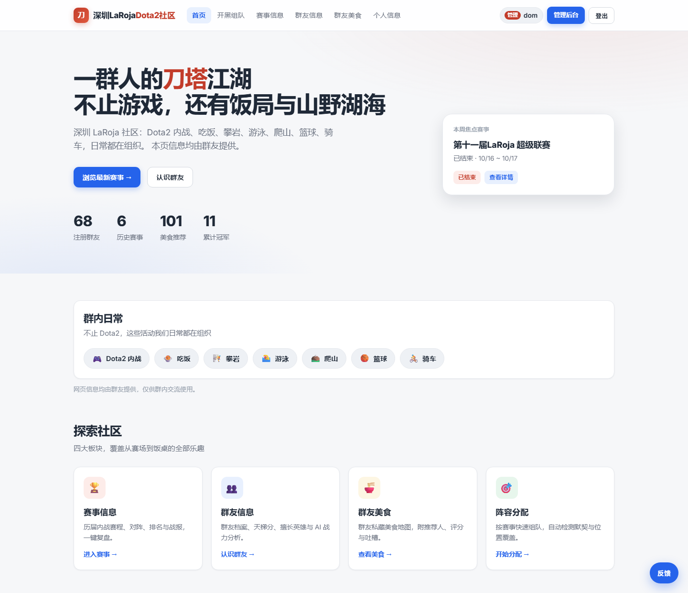

**定位**：一眼看清这个群在干什么。

- 顶部四个数字：注册群友 66 / 历史赛事 6 / 美食推荐 101 / 累计冠军 11
- 「本周焦点赛事」直接链到正在进行的比赛
- 「群内日常」标签：Dota2 内战、吃饭、攀岩、游泳、爬山、篮球、骑车 —— 不只 Dota2
- 「探索社区」四个入口卡片，新群友不用翻导航也能找到地方

---

## 三、赛事信息

### 3.1 赛事列表

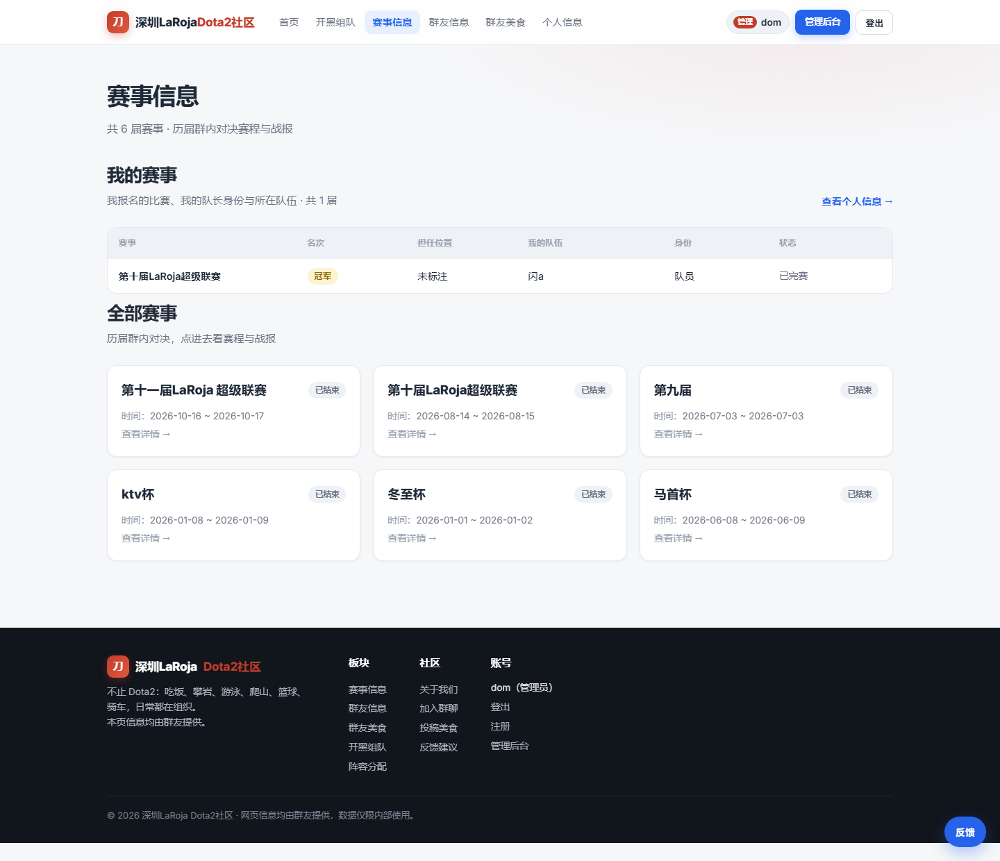

**定位**：历届比赛的入口页。

- 上半部「我的赛事」：我报过哪届、拿了什么名次、在哪个队
- 下半部「全部赛事」：每届一张卡片，带状态徽标（筹办中 / 进行中 / 已结束）
- 想看赛程战报，点进任意一届即可

### 3.2 赛事详情 · 赛事信息与赛程

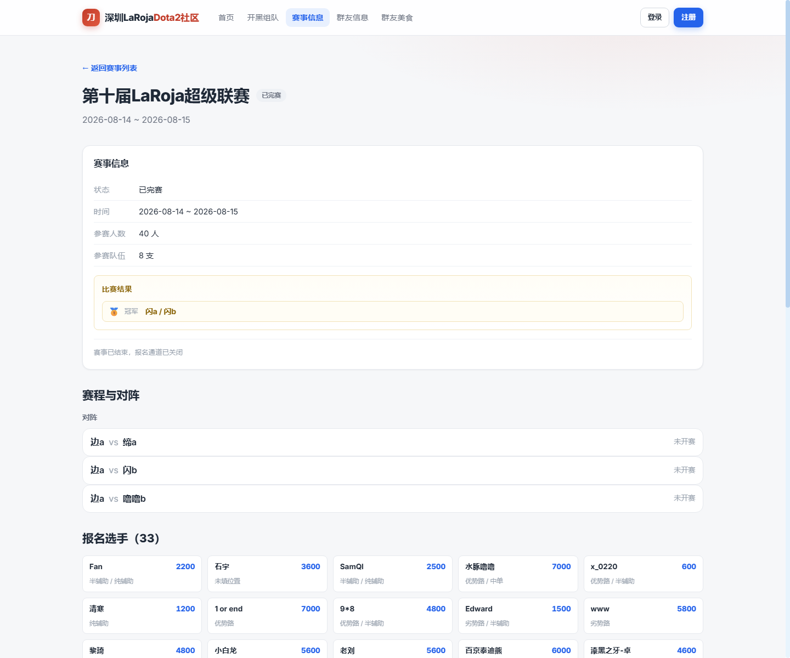

**定位**：一届比赛的完整档案。

- 赛事信息：状态、时间、参赛人数、参赛队伍数
- 比赛结果：冠军 / 亚军 / 季军（已完结赛事自动展示）
- 赛程与对阵：按阶段列每场对局，标未开赛 / 已结束与比分

### 3.3 赛事详情 · 报名选手与参赛队伍

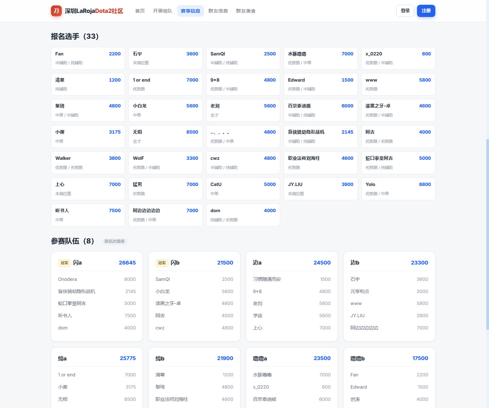

**定位**：这一届谁报了名、队怎么分的。

- 报名选手：按天梯分从高到低排，附擅长位置，一眼看出强弱分布
- 参赛队伍：每队的队长、队伍总分、成员明细（含每人天梯分）
- 名次徽标直接标在队名旁

---

## 四、群友信息

### 4.1 群友列表

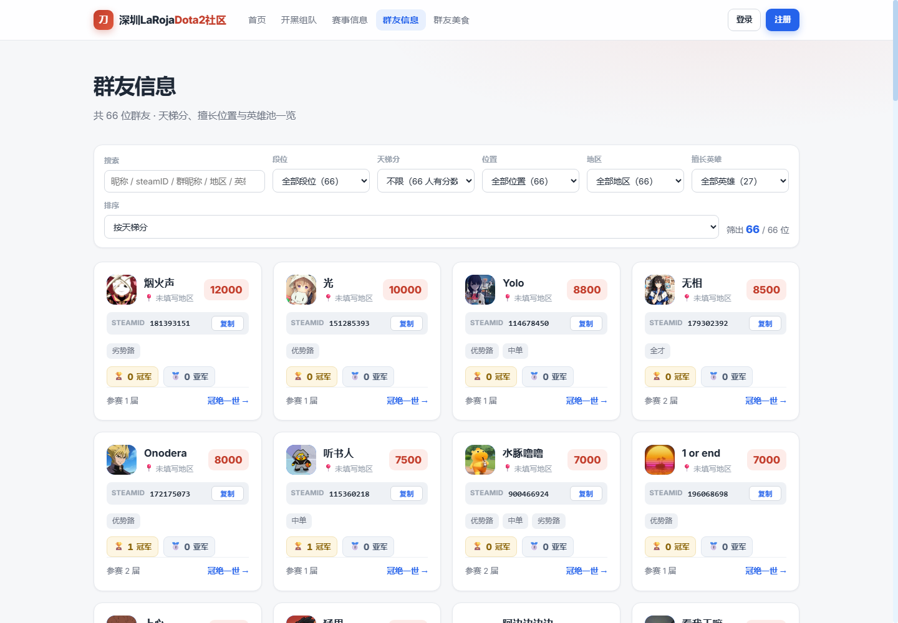

**定位**：群友档案总表，找队友前先来这里。

- 默认按天梯分排序，卡片右上角就是分数
- 六个维度筛选：段位、天梯分区间、擅长位置、地区、擅长英雄，外加关键词搜索（昵称 / SteamID / 群昵称）
- 每张卡片带 SteamID 与一键复制，方便直接加好友
- 卡片底部显示冠亚军数与参赛届数

移动端自动切成单列，手机上看同样完整：

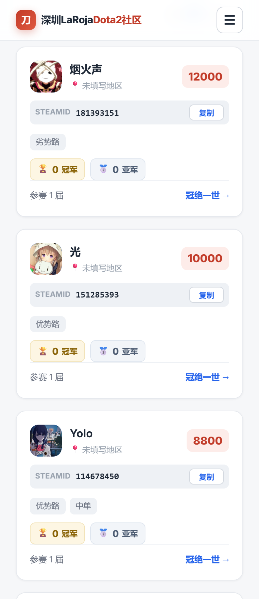

### 4.2 群友详情

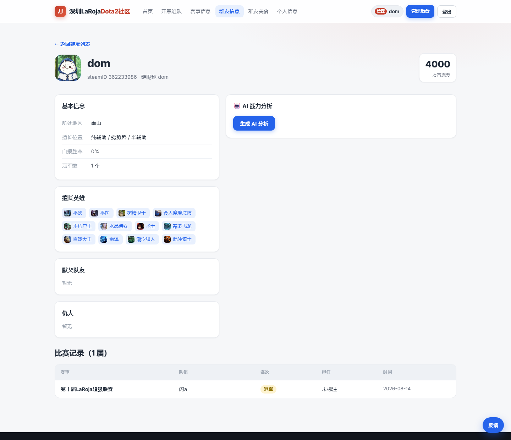

**定位**：单个群友的完整画像。

- 基本信息：所在地区、擅长位置、自报胜率、冠军数
- 擅长英雄：按英雄图标列出，不用再问「你会玩什么」
- 默契队友 / 仇人：群内关系记录，分组时很有用
- 比赛记录：参加过哪届、哪个队、什么名次
- 「AI 战力分析」：根据资料与历史战绩生成一份评估

---

## 五、开黑组队

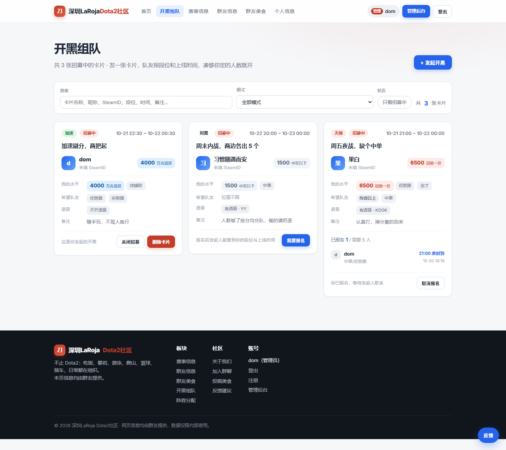

**定位**：替代群里刷屏的「有人开黑吗」。

- 每张卡片可以自己起名（不填就默认「昵称喊你来开黑了」），标题直接显示在卡片上
- 卡片带模式徽标：天梯 / 普通匹配 / 单一征召 / 加速 / 对黑
- 招募信息写清楚：需要几个人、我的水平、希望队友什么段位和位置、用什么语音、开始时间与时长
- 别人看到直接「我要报名」，报名区会显示已报名人数 / 需要人数，以及每个报名者的段位和预计上号时间
- 发起人可以随时「关闭招募」或删卡
- 支持按卡片名称 / 昵称 / SteamID / 段位 / 时间搜索，也能按模式、状态筛

自己发布的卡片长这样（标题即卡片名称）：

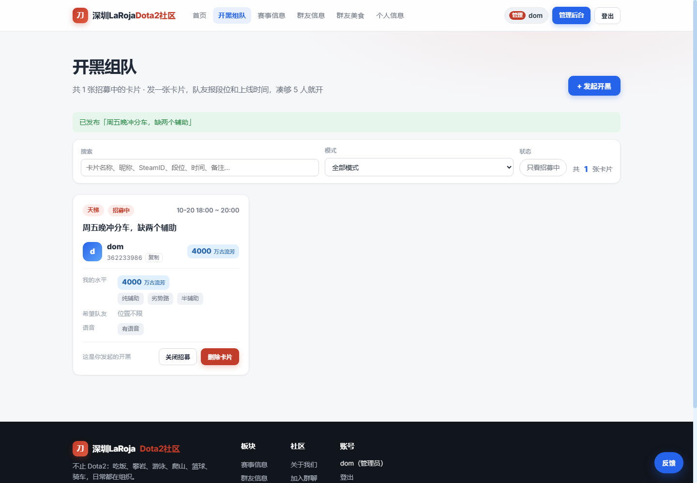

---

## 六、群友美食

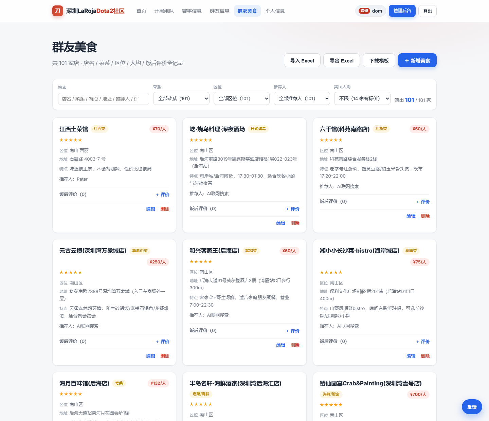

**定位**：打完去哪儿吃，不用再翻聊天记录。

- 目前收录 101 家店
- 每家店记录：菜系、区位、详细地址、人均、特色、推荐人
- 四维筛选 + 搜索：菜系、区位、推荐人、人均区间
- 每店下方是「饭后评价」，群友可以写多条，评分与吐槽都在
- 管理员可直接编辑、删除，也支持 Excel 批量导入导出（模板可下载）

---

## 七、个人信息与我的赛事

### 7.1 个人信息

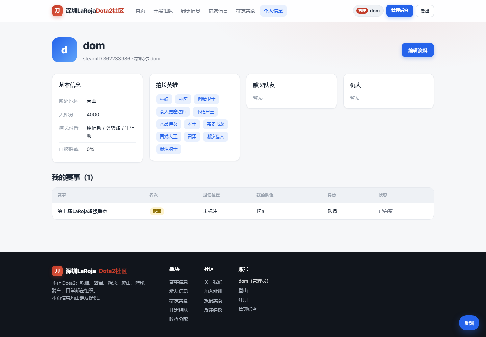

**定位**：自己的资料卡片，也是报名比赛的前提。

- 基础信息 + 擅长英雄 + 默契队友 / 仇人，一屏可改
- 下方直接汇总「我的赛事」

### 7.2 我的赛事

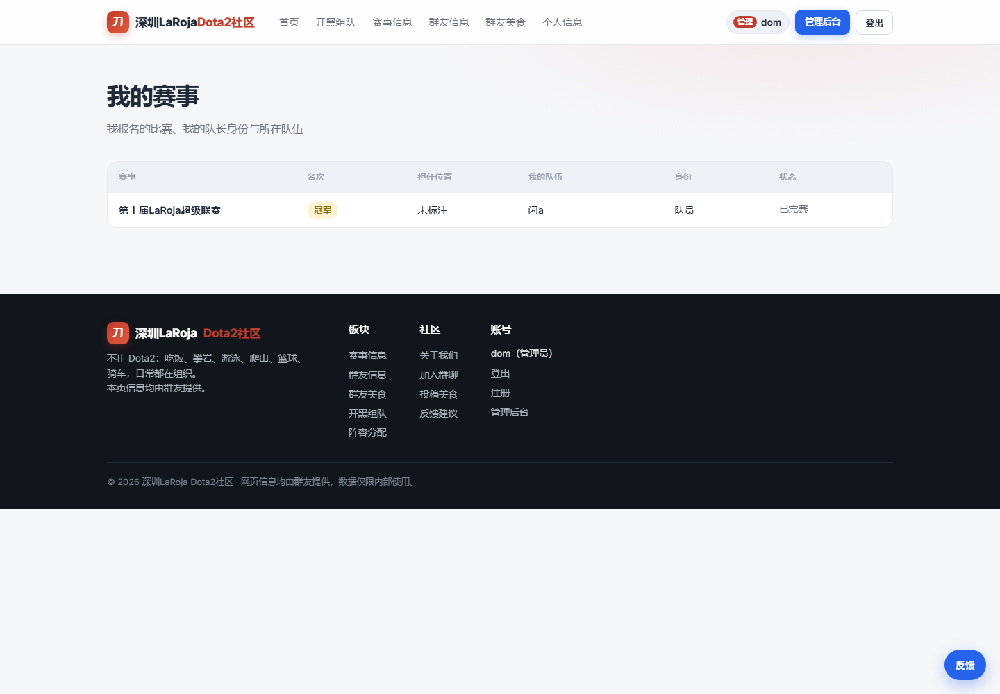

**定位**：只关心跟我有关的那几场。

- 列出席赛事、名次、担任位置、我的队伍、身份（队长 / 队员）、状态

---

## 八、登录与注册

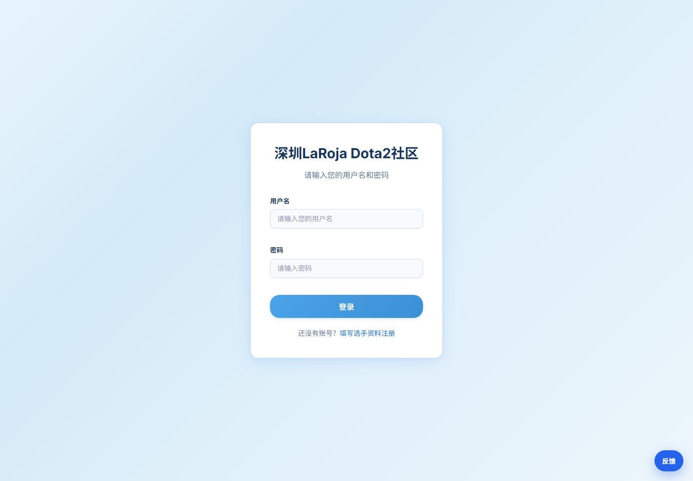

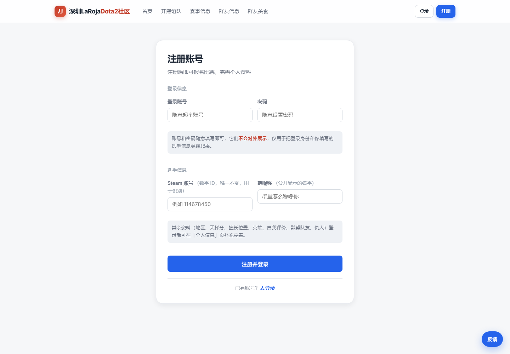

- 账号密码登录，登录状态保持 30 天，不用每次输
- 注册只要四样：账号、密码、Steam 账号（数字 ID）、群昵称；其余资料登录后慢慢补
- 注册页明确提示：账号密码只用于登录，不会对外展示

---

## 九、反馈通道

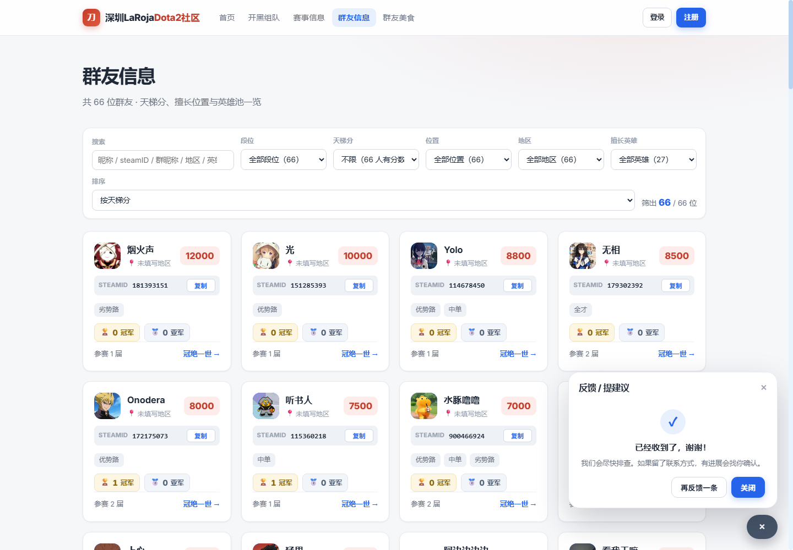

**定位**：群友发现问题不用再单独私聊管理员。

- 全站右下角常驻「反馈」按钮，任何页面都能提
- 分两类：遇到问题 / 想要的功能
- 提交时自动带上当前页面、浏览器平台、账号，管理员不用再问「你用的什么手机」
- 除了手动反馈，**页面自身的报错也会自动上报**，包括接口 5xx、请求超时、JS 异常、页面卡住
- 管理员侧进「售后工单」统一处理，可按类型、状态筛，处理完标记已处理 / 忽略

---

## 十、管理员视角

### 10.1 管理后台

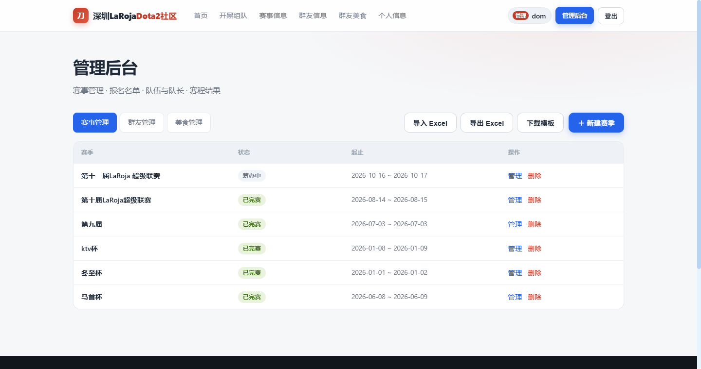

- 三个页签：赛事管理 / 群友管理 / 美食管理
- 赛事列表直接显示状态与起止时间，可管理、可删除
- 支持 Excel 导入赛事、导出全部赛事、下载模板、新建赛季

### 10.2 赛事编辑 · 队伍与队长

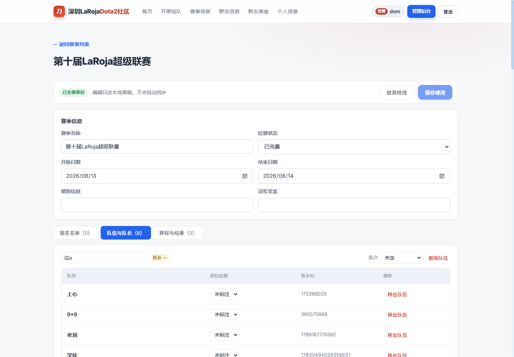

- 三个页签：报名名单 / 队伍与队长 / 赛程与结果
- 队伍内可直接设队长、标注担任位置、移出队员
- 编辑只改本地草稿，点「保存修改」才写库，改坏了可以「放弃修改」

### 10.3 赛事编辑 · 赛程与结果

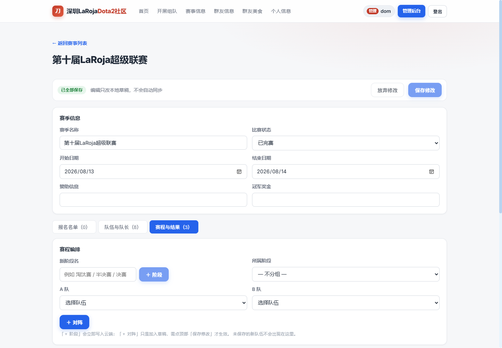

- 按阶段（淘汰赛 / 半决赛 / 决赛）编排对局
- 选好 A 队 B 队即可加对阵，录入比分后自动判定胜负

### 10.4 报名名单与整包导入

单个赛事层面也能管报名：选选手「加入名单」、「补录队伍成员进名单」，也可以对已有名单改分、设队长、移除。

更省事的方式是整包导入 —— 一个 Excel 四个 sheet（赛事信息 / 报名名单 / 队伍与成员 / 赛程对阵），导进去之前先给你一份预览：每张表几行、哪些是新增、哪些是更新。导入采用**合并**语义：同名的更新，没有的新增，**不会删除库里已有数据**，空着的格子也不会清空原内容。所以同一份表反复导不会重复建赛事。

### 10.5 售后工单

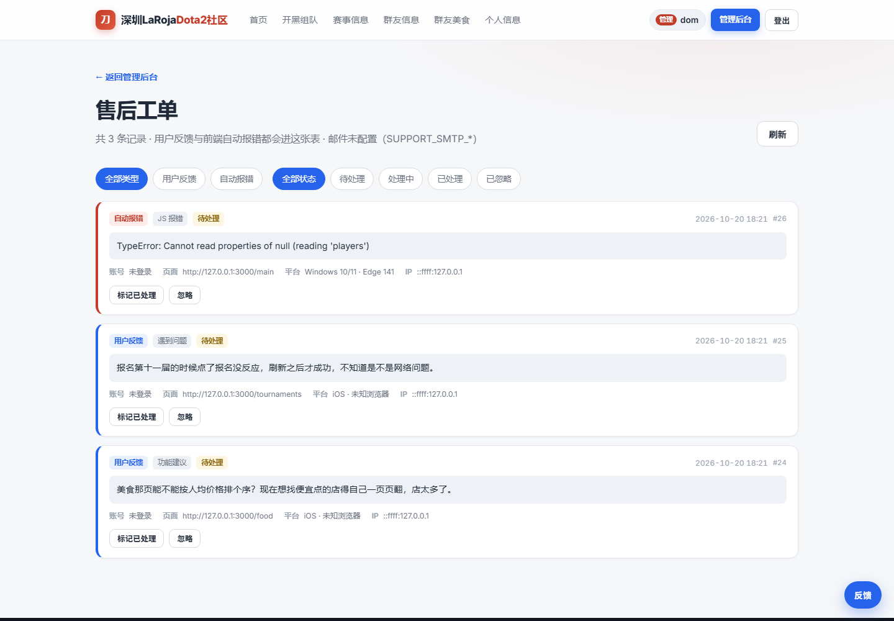

- 手动反馈与自动报错都汇总在这一张表
- 按类型（用户反馈 / 自动报错）、状态（待处理 / 处理中 / 已处理 / 已忽略）筛选
- 每条带账号、页面、平台、IP、时间，需要时可以展开技术细节
- 配了邮件后，新工单会同时发一封邮件提醒管理员

### 10.6 阵容分配工具

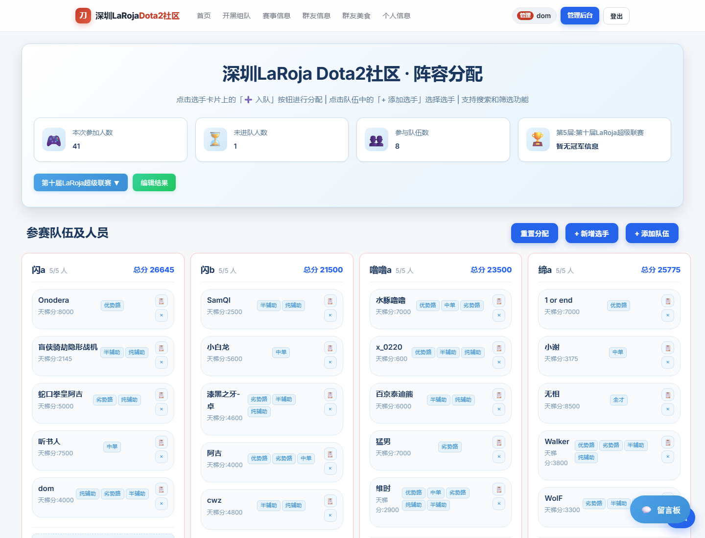

**定位**：群内比赛的组队与分队工具，也是这个站最早的功能。

- 选一届赛事后，左边是未进队选手，点击选手卡片上的「+ 入队」即可分配到任意队伍
- 顶部实时统计：本次参加人数、未进队人数、参与队伍数
- 支持按昵称 / SteamID / 群昵称 / 擅长位置搜索，也能按位置筛（优势路 / 中单 / 劣势路 / 半辅助 / 纯辅助 / 全才）
- 队伍卡片显示总分与每人的天梯分，方便做分差控制
- 一键「重置分配」、「新增选手」、「添加队伍」，分完可直接保存配置

---

## 十一、附录

### 截图清单

| 目录 | 用途 | 文件 |
|---|---|---|
| `screenshots/public/` | 对外介绍用，均为真实数据 | home、tournaments、tournament-detail-info、tournament-detail-signups、members-cards、members-cards-mobile、member-detail、party、party-card-title、food、profile、my-tournaments、login、register、feedback-widget、feedback-widget-mobile |
| `screenshots/admin/` | 管理后台，可对外展示 | admin-list、admin-teams、admin-matches、admin-support、main |
| `screenshots/_internal/` | 内部验证留存，**含测试数据，不对外** | admin-signups（该届报名名单为空态）、admin-excel-preview、tournament-package-import、tournament-package-result |

### 补充说明

- 所有截图均为 1440 宽桌面端（标注 mobile 的为 390 宽移动端）
- 图中账号 `dom` 为管理员，所以在美食页能看到「编辑 / 删除」，普通群友看不到这些按钮
- 页面文案与数据会随群内活动变化，正式对外前建议按当期数据重拍
